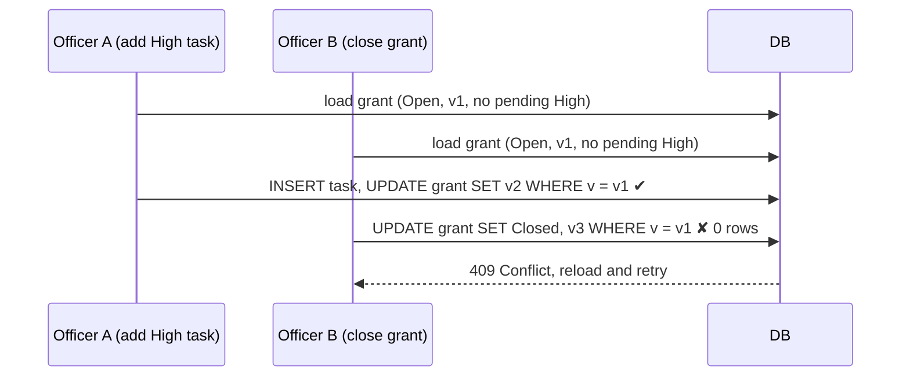

# Design

Scope of this version: architecture, data model, business rules (BR-1 to BR-6), edge cases and testing strategy. The operations needs (OP-1 to OP-6) are **not yet decided**. They get a separate pass: each one will be either designed here or listed as a limitation in `README.md`.

Spec references (§, BR-n, OP-n) point to `docs/CONTEXT.md`. Items marked **[Open]** still need a decision.

## 1. Stack

| Concern | Decision |
|---|---|
| Back end | C# / .NET 10, ASP.NET Core Web API (controllers) |
| Data access | EF Core with SQLite. The app's database mode (file or in-memory) is decided in the OP pass. Tests use SQLite in-memory. |
| Errors | `ProblemDetails` (RFC 9457) for every error response, produced by one exception-handling middleware |
| Time | `TimeProvider`, injected. Business logic never calls `DateTime.Now` or `DateTime.UtcNow` (BR-6). |
| Front end | React + TypeScript (Vite) |

## 2. Architecture

A simple layered architecture: three projects plus one test project.

```
src/
├─ GrantTracker.Api/              # controllers, DTOs, application services, error mapping, Program.cs
├─ GrantTracker.Domain/           # Grant, GrantTask, enums, rules as methods; no dependencies
└─ GrantTracker.Infrastructure/   # AppDbContext, EF configuration, migrations, seeding
tests/
└─ GrantTracker.Tests/            # Domain/ (no database), Api/ (SQLite in-memory)
ui/src/
```

**Dependencies:** Api → Domain and Infrastructure. Infrastructure → Domain. Domain → nothing.

**Responsibilities:**
- **Domain** owns the business rules. Entity methods (`Grant.AddTask`, `Grant.Close`, `GrantTask.Complete`) enforce BR-1 to BR-5. Overdue (BR-6) is a pure function of the task and `today`. Domain methods receive `today` (`DateOnly`) and `nowUtc` (`DateTime`) as parameters, so they're pure and testable without a clock.
- **Api application services** coordinate: load the aggregate, resolve `today` and `nowUtc` from `TimeProvider`, call the domain method, save, and map the result to a DTO. They contain no rules.
- **Controllers** are thin: bind and validate input, call a service, return a DTO.
- **Infrastructure** handles persistence only, plus the version-renewal hook (§3.4) and the seed data (§7).

Entities never leave the service layer. Controllers return DTOs.

## 3. Data model

### 3.1 Grant

| Field | Type | Constraints | Notes |
|---|---|---|---|
| Id | `Guid` | PK | Generated by the app |
| Reference | `string` | Required, max 20, **unique index** | e.g. `GR-100001` |
| OrganisationName | `string` | Required, max 200 | |
| ApplicationDate | `DateOnly` | Required | Calendar date, no time zone |
| Status | `GrantStatus` | Required, stored as a string, index | `Open = 0`, `Closed = 1`. Open is the default value. |
| ClosedNote | `string?` | Optional, max 1000 | The officer's reason for closing. Optional in every case. |
| ClosedAtUtc | `DateTime?` | Set on close | **[Open]** Proposed, for history |
| Version | `Guid` | Concurrency token | Renewed on every change (§3.4) |
| Tasks | `ICollection<GrantTask>` | Navigation | |

Grants are **never deleted** (see the Reminders section of `AI_LOG.md`). There is no create or update endpoint for grants. They come from the seed data, and the only state change is Close.

### 3.2 GrantTask

| Field | Type | Constraints | Notes |
|---|---|---|---|
| Id | `Guid` | PK | |
| GrantId | `Guid` | FK → Grant, required, `OnDelete(Restrict)` | |
| Title | `string` | Required, trimmed, 1–100 characters | BR-3 |
| DueDate | `DateOnly` | Required | BR-2 |
| Priority | `TaskPriority` | Required, stored as a string | `Low`, `Medium`, `High` |
| CreatedAtUtc | `DateTime` | Required, set by the server | From `TimeProvider` |
| CompletedAtUtc | `DateTime?` | `null` means pending | BR-4. Never overwritten once set. |
| Version | `Guid` | Concurrency token | Renewed on every change |

**Derived values (not stored):**
- `IsPending` = `CompletedAtUtc == null`
- `IsOverdue(today)` = `IsPending && DueDate < today` (BR-6)

### 3.3 Indexes

| Table | Index | Used by |
|---|---|---|
| Grant | `Reference` (unique) | Lookup, uniqueness |
| Grant | `Status` | `GET /grants?status=` |
| GrantTask | `(GrantId, CompletedAtUtc)` | Pending count per grant, BR-5 check |
| GrantTask | `(CompletedAtUtc, DueDate)` | `GET /tasks/overdue` |

### 3.4 Concurrency and versioning

SQLite has no `rowversion` type, so `Version` is a `Guid` configured with `IsConcurrencyToken()`. `AppDbContext.SaveChanges` renews it:

1. Every **Modified** `Grant` or `GrantTask` gets a new `Version`.
2. When a `GrantTask` is **Added**, its parent `Grant` also gets a new `Version`.

EF adds `WHERE Version = @original` to each UPDATE. If zero rows are affected, EF throws `DbUpdateConcurrencyException`, and the middleware maps it to **409**.

**Why rule 2:** adding a task and closing a grant are both "updates to the grant". Without rule 2, the following race breaks BR-1 or BR-5 (OP-2):



Whichever request commits second fails. On retry, it sees the new state: BR-5 now blocks the close, or BR-1 now blocks the add.

Completing a task changes only that task's `Version`, not the grant's. A completion racing with a close can't break a rule. At worst, the close is rejected under BR-5 and succeeds when retried.

The version check happens on the server within a single request (load → change → save). The client doesn't send a version (no `If-Match`). **[Open]** Revisit this in the OP pass if we want to protect against officers acting on a stale screen.

## 4. Business rules

`today` = the current date in the program's time zone, from `TimeProvider`. **[Open]** Which time zone (§4.7).

### BR-1: No task on a closed grant
- `Grant.AddTask` throws `BusinessRuleException("BR-1")` if `Status == Closed`.
- API: **409**, title "Grant is closed".
- UI: the Add task form is disabled for a closed grant.

### BR-2: Due date
- Rejected if `DueDate < today` or `DueDate < ApplicationDate`.
- Boundaries: `DueDate == today` is **allowed**, and `DueDate == ApplicationDate` is **allowed**.
- Applies only when a task is **created**. Existing tasks are never re-validated, because they become past-due naturally, which is what BR-6 is for.
- API: **400** `ValidationProblemDetails`, with the error keyed on `dueDate` so the UI can show it on the field.
- UI: client-side check against the browser's date. The server is the authority. If the dates differ near midnight, the server error is shown.

### BR-3: Title
- Trimmed first. Then required (not empty and not whitespace-only) and at most 100 characters.
- Length is counted in .NET `string.Length` (UTF-16 code units). The UI counts the same way (JavaScript `.length`).
- API: **400** `ValidationProblemDetails`, keyed on `title`. The DB column also has max length 100, as a second line of defence.

### BR-4: Complete a task
- `GrantTask.Complete(nowUtc)`: if pending, set `CompletedAtUtc = nowUtc`. If already completed, **change nothing**.
- API: `PUT /tasks/{id}/complete` returns **200** with the task in both cases. In the repeat case, the response carries the **original** `CompletedAtUtc`.
- **Why 200 and not 409:** `PUT` is meant to be idempotent. The caller wants "this task is completed", and it already is. A retry over an unreliable connection (OP-3) must not show the officer an error. Returning the original date also shows that it didn't change.
- UI: the Complete button is shown only on pending tasks.
- **[Open]** Can a pending task on a **closed** grant be completed (§4.7)?

### BR-5: Close a grant
- `Grant.Close(note, nowUtc)`:
  - Already Closed → no-op. Note and `ClosedAtUtc` unchanged.
  - Any task that is **pending and High priority** → throw `BusinessRuleException("BR-5")`. Completed High tasks don't block the close (seed GR-100001).
  - Otherwise → `Status = Closed`, `ClosedNote = note` (trimmed, empty becomes `null`), `ClosedAtUtc = nowUtc`. Pending Low or Medium tasks stay as they are.
- API: `PUT /grants/{id}/close` with body `{ "note": "..." }` (optional).
  - Success, or already closed → **200** with the grant.
  - BR-5 → **409**, title "Grant has pending High-priority tasks", with the blocking task ids in an extension field.
- UI:
  - The Close button is **disabled** when the grant is already closed or has a pending High task, with a tooltip giving the reason.
  - Clicking Close always opens a confirmation dialog with an optional note field.
  - No pending tasks: "Close grant GR-xxxx?"
  - Pending tasks: "There are still N pending tasks. Do you still want to close the grant?"
  - If the API still returns 409 (the state changed since the screen loaded), the dialog shows the ProblemDetails `title` and `detail`, and the grant reloads.
  - The pending counts come from `GET /grants/{id}`. No extra endpoint.

### BR-6: Overdue
- Overdue = pending and `DueDate < today`. Due today is **not** overdue.
- `GET /tasks/overdue`: ordered by `DueDate` ascending (most overdue first), then `Priority` descending, then `Id` (so the order is deterministic).
- Each item includes the grant reference and organisation, so the list makes sense without the grant screen.
- UI: overdue tasks are highlighted on the grant screen.
- **[Open]** Exclude tasks on closed grants (§4.7)?

### 4.7 Open questions on the rules

| # | Question | Options | Recommendation |
|---|---|---|---|
| Q1 | Which time zone defines "today"? | (a) UTC, (b) one configured program time zone, (c) per-officer time zone sent by the client | **(b)** A setting such as `App:TimeZone`. It's simple and deterministic, and tests set it explicitly. (c) complicates BR-2 for little gain. |
| Q2 | Can a pending task on a closed grant be completed? | (a) Yes, (b) No, the closed grant is read-only (409) | **(b)** Closing means the work is finished. The closed note explains any leftover tasks. |
| Q3 | Do pending tasks on closed grants appear in the overdue list? | (a) Yes, (b) No | **(b)** Otherwise they stay overdue forever with no possible action. Follows from Q2. |
| Q4 | Add `ClosedAtUtc` to Grant? | Yes / No | **Yes.** Cheap, and it records when the grant closed next to why. |

## 5. API and error contract

| Endpoint | Success | Errors |
|---|---|---|
| `GET /grants?status=Open\|Closed` | 200: list including `pendingTaskCount` | 400 for an invalid status |
| `GET /grants/{id}` | 200: grant with its tasks, each flagged `isOverdue` | 404 |
| `POST /grants/{id}/tasks` | 201 + `Location`, the task | 400 (BR-2, BR-3, bad input), 404, 409 (BR-1, concurrency) |
| `PUT /tasks/{id}/complete` | 200, the task (also when already completed) | 404, 409 (concurrency) |
| `PUT /grants/{id}/close` | 200, the grant (also when already closed) | 404, 409 (BR-5, concurrency) |
| `GET /tasks/overdue` | 200: list | — |

Enums are serialised as strings. `DateOnly` is serialised as `"YYYY-MM-DD"`. `DateTime` values are ISO 8601 UTC with a `Z` suffix.

### 5.1 Error handling

One exception-handling middleware, using ASP.NET Core's `UseExceptionHandler` + `IExceptionHandler` + `AddProblemDetails`, catches everything thrown by controllers and services and writes an RFC 9457 body:

| Exception | Status | `type` / `code` | `title` |
|---|---|---|---|
| Model binding or validation failure, BR-2, BR-3 | 400 | `validation` | "One or more validation errors occurred." + `errors{field: [...]}` |
| `NotFoundException` | 404 | `not-found` | "Grant not found" / "Task not found" |
| `BusinessRuleException` BR-1 | 409 | `BR-1` | "Grant is closed" |
| `BusinessRuleException` BR-5 | 409 | `BR-5` | "Grant has pending High-priority tasks" |
| `DbUpdateConcurrencyException` | 409 | `concurrency-conflict` | "The record was changed by someone else. Reload and try again." |
| Anything else | 500 | `internal` | "An unexpected error occurred." No exception details in the body. |

Every body includes `status`, `title`, `detail`, `instance` (the request path) and `traceId`. The UI reads `title`/`detail` for messages and `errors` for field errors.

Expected outcomes don't use exceptions: "already completed" and "already closed" are normal 200 paths.

## 6. Edge cases

| Case | Behaviour |
|---|---|
| Title with leading or trailing spaces | Trimmed and then validated. Stored trimmed. |
| Title of exactly 100 / 101 characters (after trimming) | Accepted / 400 |
| Whitespace-only title | 400 (BR-3) |
| Due date today / yesterday | Accepted / 400 (BR-2) |
| Due date equal to / one day before ApplicationDate | Accepted / 400 (BR-2) |
| Invalid priority value or missing field | 400 |
| Unknown grant or task id, or an id that isn't a Guid | 404 (route constraint `:guid` → 404) |
| Complete an already-completed task | 200, `CompletedAtUtc` unchanged (BR-4) |
| Close an already-closed grant | 200, note and `ClosedAtUtc` unchanged |
| Close with only *completed* High tasks | Allowed |
| Close with pending Low or Medium tasks | Allowed. Tasks stay pending. Note optional. |
| Add task while another request closes the grant | One request gets a 409 (§3.4) |
| Add High task while another request closes the grant | One request gets a 409. BR-5 can't be bypassed. |
| Task due today | Not overdue. Becomes overdue tomorrow. |
| Grant with no tasks | `pendingTaskCount = 0`, can be closed |
| Server date and browser date differ near midnight | The server decides. The UI shows the server's 400. |

## 7. Seed data

Seeded at start-up from `TimeProvider`'s `today`, so the overdue logic can always be demonstrated (§8 of CONTEXT). It covers every rule:

| Grant | Demonstrates |
|---|---|
| GR-100001 | Overdue High task (BR-6). Close blocked by a pending High task (BR-5). A completed High task that doesn't block. |
| GR-100002 | Overdue Low task. Close allowed with pending tasks (confirmation + note). |
| GR-100003 | Closed grant: adding a task is rejected (BR-1). Repeat close returns 200. |
| GR-100004 | No tasks: plain close confirmation. |

The seeder runs only if the database is empty, so it's idempotent.

## 8. Testing strategy

One command: `dotnet test` (plus `npm test` in `ui/` if UI tests are added, **[Open]**). Tests never depend on the real date or on test order.

| Level | Location | What | How |
|---|---|---|---|
| Domain unit | `tests/GrantTracker.Tests/Domain/` | BR-1 to BR-6, every boundary in §6 | Plain objects. `today`/`nowUtc` passed as fixed values. No database, no DI. |
| API integration | `tests/GrantTracker.Tests/Api/` | Endpoints, status codes, ProblemDetails shape, seed scenarios, idempotent repeats, concurrency 409 | `WebApplicationFactory` + SQLite in-memory (one open connection per test, so each test gets its own fresh database) + `FakeTimeProvider` pinned to a fixed instant |
| UI (optional) | `ui/src/**/*.test.tsx` | Add-task form validation, Close button disabled states, API error display | Vitest + Testing Library, API mocked |

**Key tests:**
- BR-2 at both boundaries (today, ApplicationDate), with `FakeTimeProvider` set near midnight in the configured time zone.
- BR-4: complete, advance the fake clock, complete again → same `CompletedAtUtc`, 200.
- BR-5: pending High blocks the close (409 + `title`). A completed High task doesn't block.
- BR-6: due today is not overdue. Ordering is most overdue first, with deterministic tie-breaking.
- Concurrency (§3.4): load the grant in two DbContexts, add a task in one, close in the other → the second save throws, and the API returns 409. This is also the "risk from §3" test the spec asks for (OP-2).
- 500 path: an unexpected exception returns a generic ProblemDetails without a stack trace.

**Isolation:** each test builds its own factory or database. There is no shared mutable state, so tests can run in any order or in parallel.
