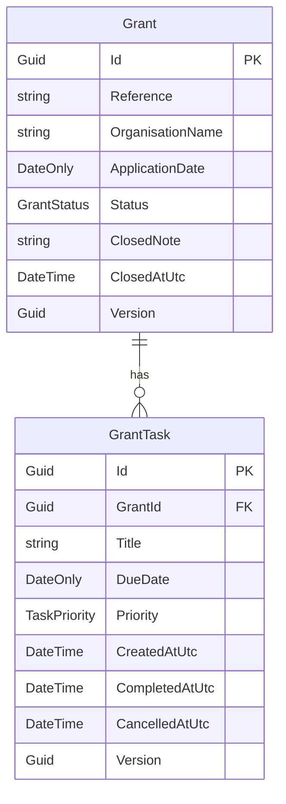
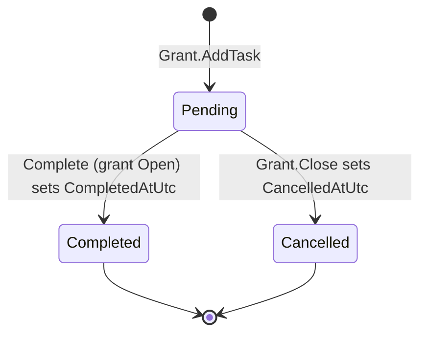
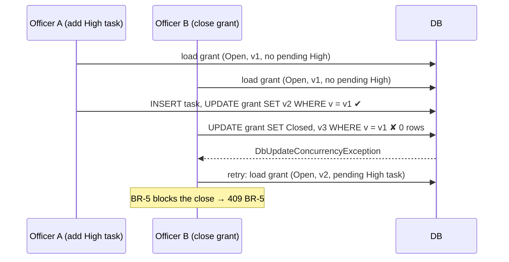

# Design

Scope of this version: architecture, data model, business rules (BR-1 to BR-6), operations needs, edge cases and testing strategy. Of the operations needs, OP-2, OP-3 and OP-5 are built (§6). OP-1, OP-4 and OP-6 are not built; they're recorded as limitations in §10.

Spec references (§, BR-n, OP-n) point to `docs/CONTEXT.md`. Items marked **[Open]** still need a decision.

## 1. Stack

| Concern | Decision |
|---|---|
| Back end | C# / .NET 10, ASP.NET Core Web API (controllers) |
| Data access | EF Core with SQLite. The app uses a SQLite file with default settings (§6.2). Tests use SQLite in-memory. |
| Errors | `ProblemDetails` (RFC 9457) for every error response, produced by one exception-handling middleware |
| Time | `TimeProvider`, injected. Business logic never calls `DateTime.Now` or `DateTime.UtcNow` (BR-6). "Today" is the date in one program time zone, `Australia/Sydney` (§4.0). |
| Health checks | ASP.NET Core health checks: `/health/live` and `/health/ready` (§6.4) |
| API documentation | The built-in OpenAPI document (`Microsoft.AspNetCore.OpenApi`) and Swagger UI (`Swashbuckle.AspNetCore.SwaggerUI`), in Development only (§5) |
| Front end | React + TypeScript (Vite) |
| Tests | xUnit for .NET. Vitest + React Testing Library for a few UI cases. One command runs both: `npm test` at the repository root (§9). |

## 2. Architecture

A simple layered architecture: three projects plus one test project.

```
src/
├─ GrantTracker.Api/              # controllers, DTOs, application services, error mapping, health checks, Program.cs
├─ GrantTracker.Domain/           # Grant, GrantTask, enums, rules as methods; no dependencies
└─ GrantTracker.Infrastructure/   # AppDbContext, EF configuration, migrations, seeding
tests/
└─ GrantTracker.Tests/            # Domain/ (no database), Infrastructure/ and Api/ (SQLite in-memory)
ui/src/                           # React app; Vitest tests next to the components they test
```

**Dependencies:** Api → Domain and Infrastructure. Infrastructure → Domain. Domain → nothing.

**Responsibilities:**
- **Domain** owns the business rules. Entity methods (`Grant.AddTask`, `Grant.Close`, `GrantTask.Complete`) enforce BR-1 to BR-5 and the read-only rule for closed grants. Overdue (BR-6) is a pure function of the task and `today`. Domain methods receive `today` (`DateOnly`) and `nowUtc` (`DateTime`) as parameters, so they're pure and testable without a clock.
- **Api application services** coordinate: load the aggregate, resolve `today` and `nowUtc` from `IAppClock`, call the domain method, save, and map the result to a DTO. They also retry the whole sequence when a save hits a conflict (§6.2), and handle repeated task creation (§6.3). They contain no business rules.
- **Controllers** are thin: bind and validate input, call a service, return a DTO.
- **Infrastructure** handles persistence only, plus the version-renewal hook (§3.5) and the seed data (§8).

`IAppClock` (in Api) wraps `TimeProvider` and the configured zone. It exposes `DateTime UtcNow` and `DateOnly Today`. It's the only place that converts UTC to the program's local date.

Entities never leave the service layer. Controllers return DTOs.

## 3. Data model



### 3.1 Grant

| Field | Type | Constraints | Notes |
|---|---|---|---|
| Id | `Guid` | PK | Generated by the app |
| Reference | `string` | Required, max 20, **unique index** | e.g. `GR-100001` |
| OrganisationName | `string` | Required, max 200 | |
| ApplicationDate | `DateOnly` | Required | Calendar date in the program time zone |
| Status | `GrantStatus` | Required, stored as int (`Open = 0`, `Closed = 1`), index | Open is the default value. Serialised as string in API. |
| ClosedNote | `string?` | Optional, max 1000 | The officer's reason for closing. Optional in every case. |
| ClosedAtUtc | `DateTime?` | Set on close | When the grant was closed |
| Version | `Guid` | Concurrency token | Renewed on every change (§3.5) |
| Tasks | `ICollection<GrantTask>` | Navigation | |

Grants are **never deleted** (see §10.1). There is no create or update endpoint for grants. They come from the seed data, and the only state change is Close.

### 3.2 GrantTask

| Field | Type | Constraints | Notes |
|---|---|---|---|
| Id | `Guid` | PK | Chosen by the client (the UI) when the task is created, so creating a task is safe to repeat (§6.3) |
| GrantId | `Guid` | FK → Grant, required, `OnDelete(Restrict)` | |
| Title | `string` | Required, trimmed, 1–100 characters | BR-3. Enforced by the domain. The column's max length isn't enforced by SQLite (§3.6). |
| DueDate | `DateOnly` | Required | BR-2. A calendar date in the program time zone. |
| Priority | `TaskPriority` | Required, stored as int (`Low = 1`, `Medium = 2`, `High = 3`) | Stored as integer for database sorting (`High > Medium > Low`); serialised as string in API. |
| CreatedAtUtc | `DateTime` | Required, set by the server | From `IAppClock` |
| CompletedAtUtc | `DateTime?` | | BR-4. Never overwritten once set. |
| CancelledAtUtc | `DateTime?` | | Set when the grant closes. Equal to the grant's `ClosedAtUtc`. |
| Version | `Guid` | Concurrency token | Renewed on every change |

**Check constraint:** `CK_GrantTask_CompletedXorCancelled`: `CompletedAtUtc IS NULL OR CancelledAtUtc IS NULL`. A task can never be both completed and cancelled. SQLite enforces this, and it's configured with `ToTable(t => t.HasCheckConstraint(...))`.

### 3.3 Task status (derived, not stored)

The task's status is **not a column**. It's derived from the two timestamps, so they're the only source of truth:

| CompletedAtUtc | CancelledAtUtc | Status |
|---|---|---|
| null | null | **Pending** |
| set | null | **Completed** |
| null | set | **Cancelled** |
| set | set | Impossible (check constraint) |

**How it's implemented:**
- **Domain:** a read-only property `GrantTask.Status` (`GrantTaskStatus` enum) computes the value. EF ignores it (`builder.Ignore(t => t.Status)`). The timestamp setters are private, so only `Complete()` and `Cancel()` change them.
- **Queries:** EF can't translate an ignored property, so queries use the columns directly, through shared expressions in Domain:
  - `GrantTaskQueries.IsPending` = `t => t.CompletedAtUtc == null && t.CancelledAtUtc == null`
  - `GrantTaskQueries.IsOverdue(today)` = `IsPending && t.DueDate < today`

  These live in one place, so the rule isn't copied across services.
- **API:** DTOs still expose `status` (`"Pending"`, `"Completed"`, `"Cancelled"`), so the UI doesn't need to know the rule.

**Task lifecycle:**



`Completed` and `Cancelled` are terminal states. Re-opening is not built (§10.3).

### 3.4 Indexes

| Table | Index | Used by |
|---|---|---|
| Grant | `Reference` (unique) | Lookup, uniqueness |
| Grant | `Status` | `GET /grants?status=` |
| GrantTask | `GrantId` | FK, loading a grant's tasks |
| GrantTask | `(GrantId, Priority)` **filtered** `WHERE CompletedAtUtc IS NULL AND CancelledAtUtc IS NULL` | Pending count per grant, BR-5 check, cancel on close |
| GrantTask | `DueDate` **filtered** `WHERE CompletedAtUtc IS NULL AND CancelledAtUtc IS NULL` | `GET /tasks/overdue` |

SQLite supports partial (filtered) indexes. EF configures them with `HasFilter(...)`. They contain only pending tasks, so they stay small as completed and cancelled tasks build up.

### 3.5 Concurrency and versioning

SQLite has no `rowversion` type, so `Version` is a `Guid` configured with `IsConcurrencyToken()`. `AppDbContext.SaveChanges` renews it:

1. Every **Modified** `Grant` or `GrantTask` gets a new `Version`.
2. When a `GrantTask` is **Added**, its parent `Grant` also gets a new `Version`.

EF adds `WHERE Version = @original` to each UPDATE. If zero rows are affected, EF throws `DbUpdateConcurrencyException`, and the service retries the request against the new state (§6.2). Only if all 3 attempts conflict does the middleware map it to **409** `concurrency-conflict`. `SaveChanges` runs in one transaction, so a failed close (grant and its cancelled tasks) is rolled back completely.

**Why rule 2:** adding a task and closing a grant are both "updates to the grant". Without rule 2, the following race breaks BR-1 or BR-5 (OP-2):



Whichever request saves second fails, and the service retries it (§6.2). On retry, it sees the new state: BR-5 now blocks the close, or BR-1 now blocks the add.

**Complete vs. close:** closing updates every pending task (setting `CancelledAtUtc`), so each of those tasks gets a new Version too. If a task is completed while the grant is being closed, the second request to save fails and is retried. A task can't end up both completed and cancelled (the check constraint is the second line of defence). On retry:
- If the completion won, the close goes through (unless BR-5 blocks it).
- If the close won, the completion is rejected because the grant is now read-only (§4.7).

Completing a task doesn't change the grant's Version.

The version check happens on the server within a single request (load → change → save). The client doesn't send a version (no `If-Match`). §6.2 explains why it isn't needed.

### 3.6 Dates and times in the database

SQLite has no date or time types, so EF Core stores them as text. The code has two kinds of date value, and they're stored differently:

| Kind | .NET type | Fields | Stored in SQLite as | PostgreSQL equivalent |
|---|---|---|---|---|
| Calendar date in the program time zone (Sydney) | `DateOnly` | `ApplicationDate`, `DueDate` | `TEXT`, `'YYYY-MM-DD'` | `date`: no time and no time zone |
| Instant | `DateTime`, always UTC | `CreatedAtUtc`, `CompletedAtUtc`, `CancelledAtUtc`, `ClosedAtUtc` | `TEXT`, `'YYYY-MM-DD HH:MM:SS.FFFFFFF'`, with no offset | `timestamp with time zone`: stored as UTC |

- **Calendar dates are not instants.** A due date of 2026-03-11 means that day in Sydney. It is never converted to or from UTC, in the database, the API or the UI. Comparing `'YYYY-MM-DD'` text sorts and compares correctly, so `DueDate < today` works in SQL.
- **UTC converter.** SQLite (like SQL Server's `datetime2`) loses `DateTime.Kind`: values come back as `Unspecified`. The API would then serialise them without the `Z` suffix, and a client would read them as local time. A value converter on every `DateTime` and `DateTime?` property in `AppDbContext`:
  - **On read:** marks the value as UTC (`DateTime.SpecifyKind(value, DateTimeKind.Utc)`). The stored text isn't shifted.
  - **On write:** throws if the value isn't UTC. A non-UTC value means some code used `DateTime.Now` or a local time, which is a bug. It's better to fail loudly than to store a shifted time.
- **PostgreSQL** (§10.5) stores `timestamp with time zone` as UTC, and Npgsql already refuses non-UTC `DateTime` values. `DateOnly` maps to `date`, which has no time zone. The converter stays harmless there.
- **No `DateTimeOffset`.** EF Core can't sort or compare `DateTimeOffset` columns in SQLite, and the offset adds nothing when every instant is UTC.
- **Maximum lengths.** SQLite doesn't enforce the maximum lengths configured in EF (`Title`, `Reference`, `OrganisationName`, `ClosedNote`), so in this app the domain is the only length check. PostgreSQL and SQL Server would enforce them as a second line of defence.

## 4. Business rules

### 4.0 "Today"

`today` = the current date in **`Australia/Sydney`**, computed by `IAppClock` from `TimeProvider`. The zone is a setting (`App:TimeZoneId`, default `Australia/Sydney`, IANA id). It's checked at start-up and fails fast if invalid. All calendar dates (`ApplicationDate`, `DueDate`) are in that zone.

The API returns `today` with each grant response. The UI uses it for client-side checks and labels such as "Due today", rather than the browser's date. Multiple offices with different time zones are out of scope (§10.2).

### BR-1: No task on a closed grant
- `Grant.AddTask` throws `BusinessRuleException("BR-1")` if `Status == Closed`.
- API: **409**, title "Grant is closed".
- UI: the Add task form is disabled for a closed grant.

### BR-2: Due date
- Rejected if `DueDate < today` or `DueDate < ApplicationDate`.
- Boundaries: `DueDate == today` is **allowed**, and `DueDate == ApplicationDate` is **allowed**.
- Applies only when a task is **created**. Existing tasks are never re-validated, because they become past-due naturally, which is what BR-6 is for. A repeated create of a task that already exists is not a new creation, so BR-2 isn't checked again (§6.3).
- API: **400** `ValidationProblemDetails`, with the error keyed on `dueDate` so the UI can show it on the field.
- UI: the client-side check uses `today` from the API. The server is still the authority.

### BR-3: Title
- Trimmed first. Then required (not empty and not whitespace-only) and at most 100 characters.
- Length is counted in .NET `string.Length` (UTF-16 code units). The UI counts the same way (JavaScript `.length`).
- API: **400** `ValidationProblemDetails`, keyed on `title`. The column is configured with max length 100, but SQLite doesn't enforce it (§3.6), so the domain is the only check in this app.

### Order of checks when adding a task
1. BR-1 first. On a closed grant, the input doesn't matter: **409** `BR-1`.
2. Then BR-2 and BR-3 together. If both the title and the due date are invalid, one **400** carries both field errors, so the form can show them at once.

### BR-4: Complete a task
`GrantTask.Complete(nowUtc)` checks in this order:

| Task status | Grant status | Result |
|---|---|---|
| Completed | any | No change. **200** with the original `CompletedAtUtc`. |
| Pending | Open | `CompletedAtUtc = nowUtc`. **200**. |
| Pending or Cancelled | Closed | **409** `grant-closed` (§4.7) |

**Why repeating a completion returns 200, not 409:** `PUT` is meant to be idempotent. The caller wants "this task is completed", and it already is. A retry over an unreliable connection (OP-3) must not show the officer an error. Returning the original date also shows that it didn't change. The repeat returns 200 even after the grant has closed, because nothing changes.

UI: the Complete button is shown only on pending tasks of open grants.

### BR-5: Close a grant
`Grant.Close(note, nowUtc)`:
- Already Closed → no-op. **200**. Note, `ClosedAtUtc` and the tasks are unchanged.
- Any task that is **Pending and High priority** → throw `BusinessRuleException("BR-5")` → **409**, title "Grant has pending High-priority tasks", with the blocking task ids in an extension field. Completed High tasks don't block the close (seed GR-100001).
- Otherwise:
  - `Status = Closed`, `ClosedAtUtc = nowUtc`, `ClosedNote = note` (trimmed, empty becomes `null`).
  - Every **Pending** task (Low or Medium, since BR-5 already rules out High) → `CancelledAtUtc = nowUtc`, which makes it Cancelled.
  - **200** with the grant and its tasks.

API: `PUT /grants/{id}/close` with body `{ "note": "..." }` (optional).

UI:
- The Close button is **disabled** when the grant is closed or has a pending High task, with a tooltip giving the reason.
- Clicking Close always opens a confirmation dialog with an optional note field.
  - No pending tasks: "Close grant GR-xxxx?"
  - Pending tasks: "There are still N pending tasks. Closing the grant will cancel them. Do you still want to close the grant?"
- If the API still returns 409 (the state changed since the screen loaded), the dialog shows the ProblemDetails `title` and `detail`, and the grant reloads.
- The pending counts come from `GET /grants/{id}`. No extra endpoint.

### BR-6: Overdue
- Overdue = Pending (`CompletedAtUtc` and `CancelledAtUtc` both null) and `DueDate < today`. Due today is **not** overdue.
- **Cancelled and Completed tasks are never overdue.** Cancelled tasks can only exist on closed grants (they're cancelled by Close), so no pending task is ever hidden from the overdue list.
  - **Interpretation, stated in `README.md`:** BR-6 says "hasn't been completed". We read Cancelled as a terminal state ("will never be completed"), not as "not yet completed".
- `GET /tasks/overdue`: ordered by `DueDate` ascending (most overdue first), then `Priority` descending, then `Id` (deterministic).
- Each item includes the grant reference and organisation, so the list makes sense without the grant screen.
- UI: overdue tasks are highlighted on the grant screen.

### 4.7 Closed grants are read-only

Once a grant is Closed, neither the grant nor its tasks can change:

| Action | API | UI |
|---|---|---|
| Add task | 409 `BR-1` | Form disabled |
| Repeat a create of a task that already exists (same id and values) | 200, the existing task (§6.3) | — |
| Complete a pending or cancelled task | 409 `grant-closed`, title "Grant is closed; its tasks are read-only" | No Complete button |
| Complete a completed task | 200, no change (BR-4 repeat) | No button |
| Close again | 200, no change | Close button disabled |

The check lives in the domain (`GrantTask.Complete` asks its grant), so every entry point enforces it, including Swagger and direct API calls.

## 5. API and error contract

| Endpoint | Success | Errors |
|---|---|---|
| `GET /grants?status=Open\|Closed` | 200: list including `pendingTaskCount` | 400 for an invalid status |
| `GET /grants/{id}` | 200: grant with `today` and its tasks, each with `status` and `isOverdue` | 404 |
| `POST /grants/{id}/tasks` | 201 + `Location`, the task. 200, the existing task, when the same `id` is sent again with the same values (§6.3). | 400 (BR-2, BR-3, missing `id`, bad input), 404, 409 (BR-1, `duplicate-task-id`, concurrency) |
| `PUT /tasks/{id}/complete` | 200, the task (also when already completed) | 404, 409 (grant closed, concurrency) |
| `PUT /grants/{id}/close` | 200, the grant with its tasks (also when already closed) | 404, 409 (BR-5, concurrency) |
| `GET /tasks/overdue` | 200: list | — |
| `GET /health/live` | 200 `Healthy` (§6.4) | — |
| `GET /health/ready` | 200 `Healthy` (§6.4) | 503 `Unhealthy` when the database can't be reached |
| `GET /openapi/v1.json`, `GET /swagger` | The OpenAPI document and Swagger UI. **Development only.** | — |

`POST /grants/{id}/tasks` body: `{ "id": "<guid>", "title": "...", "dueDate": "YYYY-MM-DD", "priority": "Low" | "Medium" | "High" }`. The `id` is required (§6.3).

Enums are stored as integers in the database (`GrantStatus`: `Open = 0`, `Closed = 1`; `TaskPriority`: `Low = 1`, `Medium = 2`, `High = 3`), but serialised as strings in JSON/API DTOs (`"Open"`, `"Closed"`, `"Low"`, `"Medium"`, `"High"`). `GrantTaskStatus` enum used in DTOs and domain logic is also mapped to strings (`"Pending"`, `"Completed"`, `"Cancelled"`). `DateOnly` is serialised as `"YYYY-MM-DD"`. `DateTime` values are ISO 8601 UTC with a `Z` suffix; the UTC converter (§3.6) makes sure values read from SQLite keep it. The UI treats `"YYYY-MM-DD"` values as plain text: it never turns them into a JavaScript `Date`, which would read them as midnight UTC and show the previous day in time zones west of UTC.

### 5.1 Error handling

One exception-handling middleware, using ASP.NET Core's `UseExceptionHandler` + `IExceptionHandler` + `AddProblemDetails`, catches everything thrown by controllers and services and writes an RFC 9457 body:

| Exception | Status | `type` / `code` | `title` |
|---|---|---|---|
| Model binding or validation failure, BR-2, BR-3 | 400 | `validation` | "One or more validation errors occurred." + `errors{field: [...]}` |
| `NotFoundException` | 404 | `not-found` | "Grant not found" / "Task not found" |
| `BusinessRuleException` BR-1 | 409 | `BR-1` | "Grant is closed" |
| `BusinessRuleException` grant-closed | 409 | `grant-closed` | "Grant is closed; its tasks are read-only" |
| `BusinessRuleException` BR-5 | 409 | `BR-5` | "Grant has pending High-priority tasks" |
| `DuplicateTaskIdException` | 409 | `duplicate-task-id` | "This task id is already used by a task with different details" |
| `DbUpdateConcurrencyException` after 3 attempts (§6.2) | 409 | `concurrency-conflict` | "The record was changed by someone else. Reload and try again." |
| Anything else | 500 | `internal` | "An unexpected error occurred." No exception details in the body. |

Every body includes `status`, `title`, `detail`, `instance` (the request path) and `traceId`. `traceId` isn't part of RFC 9457; it's an extension field that ASP.NET Core adds. The UI reads `title`/`detail` for messages and `errors` for field errors.

Expected outcomes don't use exceptions: "already completed", "already closed" and "task already created" are normal 200 paths.

The health endpoints (§6.4) are outside this contract: they return a plain status word, not ProblemDetails.

## 6. Operations needs

### 6.1 What is built

| Need | Decision | Where |
|---|---|---|
| OP-2 Concurrency | Built | §6.2 |
| OP-3 Repeated requests, server unreachable | Built, in the API and the UI | §6.3 |
| OP-5 Health checks | Built | §6.4 |
| OP-1 Several copies, restarts at any time | Not built. Partly covered by OP-3 and OP-5. | §10.5 |
| OP-4 Support team investigates later | Not built | §10.6 |
| OP-6 Usage counts, overdue-list speed | Not built | §10.7 |

**Why these three:** OP-2 and OP-3 protect the data and the business rules. If they fail, rules are broken, tasks are duplicated, or officers don't know whether their work was saved. OP-5 is small and keeps officers away from a copy of the API that can't reach its data. OP-1, OP-4 and OP-6 are about deployment, diagnosis and reporting: in this version, nothing is lost or broken without them.

### 6.2 OP-2: Concurrency

The version tokens (§3.5) detect conflicting writes. This section adds a retry, so officers see an error only when a business rule really blocks them, not just because a teammate saved at the same moment.

**Retry on conflict.** Every write in the application services runs as: load → call the domain method → save. If the save hits a conflict, the service clears the DbContext's tracked entities (`ChangeTracker.Clear()`) and runs the whole sequence again, up to **3 attempts** in total.
- Conflicts that trigger a retry:
  - `DbUpdateConcurrencyException` (a version check failed).
  - A primary-key violation when inserting a `GrantTask`. This happens when two copies of the same create arrive together (§6.3).
- The domain checks the rules again on each attempt, against the current data. So a retry ends in success, a no-op, or the rule's own error (BR-1, BR-5, `grant-closed`). It can never bypass a rule.
- After 3 failed attempts: **409** `concurrency-conflict`. This needs constant contention on one grant, which is unlikely with small teams per grant.

| Race | Outcome |
|---|---|
| Two officers add tasks to the same grant | Both succeed. The second save retries and adds its task. |
| Add a High task and close the grant; the add saves first | The close retries, sees a pending High task → 409 `BR-5` |
| Add a task and close the grant; the close saves first | The add retries, sees the grant is Closed → 409 `BR-1` |
| Add a Low or Medium task and close the grant; the add saves first | The close retries and succeeds. The new task is cancelled with the others. |
| Complete a task and close the grant; the complete saves first | The close retries and succeeds. The completed task is untouched. |
| Complete a task and close the grant; the close saves first | The complete retries, sees the task is Cancelled → 409 `grant-closed` |
| Two officers complete the same task | The second retries, sees it's Completed → 200 with the first `CompletedAtUtc` |
| Two officers close the same grant | The second retries, sees it's Closed → 200, no change (the first note is kept) |

**No `If-Match`.** The client doesn't send the version it last saw. The server checks every rule against the current data when it saves, so acting on an out-of-date screen can't break a rule:
- Closing from an old screen is checked against BR-5 again.
- Completing a task someone already completed returns 200 with the original date.

`If-Match` prevents one person's edit silently overwriting another's. There are no edit endpoints (title, due date and priority can't be changed), so there's nothing for it to protect. If edit endpoints are added later, they should require `If-Match`.

**Database.** The app uses a SQLite file with default settings, for example `ConnectionStrings:Default = "Data Source=granttracker.db"`. At start-up the app applies migrations, then seeds if the database is empty (§8). SQLite allows one writer at a time, which is enough for one copy of the API in this exercise. Running several copies needs a server database (§10.5).

### 6.3 OP-3: Repeated requests and an unreachable server

**Which requests are safe to repeat**

| Endpoint | When repeated |
|---|---|
| All GETs | Read only |
| `PUT /tasks/{id}/complete` | 200 with the original `CompletedAtUtc` (BR-4) |
| `PUT /grants/{id}/close` | 200, no change (BR-5) |
| `POST /grants/{id}/tasks` | Safe, because the client chooses the task id (below) |

**Creating a task with a client-chosen id**

The client sends the new task's `id` in the body (§5). The service handles the request in this order:

1. **Input shape.** `id` missing or `Guid.Empty`, an unknown priority, or a malformed date → **400**, keyed on the field.
2. **Look up the id.** Find a task with that `id`, on any grant.
3. **If it exists:**
   - Same grant, and the same title (after trimming), due date and priority → **200** with the existing task as it is now. Nothing is created or changed.
   - Anything different → **409** `duplicate-task-id`.
4. **If it doesn't exist:** `Grant.AddTask(id, title, dueDate, priority, today, nowUtc)` checks BR-1, BR-2 and BR-3 → **201** + `Location`.

**Why the lookup comes before the rules:** a repeat must return the task that was saved, even if a rule would now reject a new one. A retry that arrives after Sydney midnight would fail BR-2 (the due date is now in the past), and a retry after the grant was closed would fail BR-1, even though the task exists.

**Two copies of the same request at the same moment:** both pass step 2 and try to insert. The second save fails on the primary key or the grant version, and the retry (§6.2) runs it again. This time step 3 finds the task and returns 200.

The UI treats 200 and 201 the same way.

**UI**

One fetch helper is used for every request. It sorts each outcome into one of three cases:

| Outcome | Shown to the officer |
|---|---|
| 2xx | Success |
| 4xx | The server's message: field errors from `errors` (BR-2, BR-3), or `title` and `detail` (BR-1, BR-5, `grant-closed`, `duplicate-task-id`, `concurrency-conflict`) |
| 5xx, a network error, or no response within **10 seconds** | A banner: "We couldn't reach the server. Your change may not have been saved. It's safe to send it again." |

- **Timeout:** an `AbortController` cancels the request after 10 seconds. A timeout doesn't mean the request failed: the server may have saved the change before the response was lost. The banner says so, and sending again is safe because every write is safe to repeat.
- **Why 10 seconds:** connections in regional offices are slow. A shorter timeout would show the banner for requests that are about to succeed.
- **Buttons** (Add task, Complete, Close) are disabled while their request is waiting, so a double-click can't send twice. They're enabled again as soon as any response arrives or the request times out, so the officer can send again.
- **Add task form:**
  - The form creates the task id with `crypto.randomUUID()` and keeps it until the server confirms the task (200 or 201). Sending again after a failure uses the same id. After a success, the form clears and creates a new id for the next task.
  - What the officer typed is kept after any failure.
- **After any 409**, the grant reloads, so the screen shows the current state.
- `crypto.randomUUID()` only works in a secure context (HTTPS or `localhost`). Development runs on `localhost`, and a real deployment would use HTTPS.

### 6.4 OP-5: Health checks

| Endpoint | Checks | Healthy | Unhealthy | Kubernetes probe |
|---|---|---|---|---|
| `GET /health/live` | Nothing beyond the process answering | 200 `Healthy` | — | Liveness |
| `GET /health/ready` | The database can be reached (`AddDbContextCheck<AppDbContext>`) | 200 `Healthy` | 503 `Unhealthy` | Readiness |

- **Liveness doesn't check the database.** If it did, a database outage would make Kubernetes restart every copy of the API. That doesn't fix the database, and it adds start-up load.
- **Readiness failing** takes the copy out of the load balancer until it can reach the database again.
- The response body is only the status word. It never includes exception details or connection strings.
- These endpoints are outside the ProblemDetails contract (§5.1). They need no login, because this version has no login.

### 6.5 Edge cases

| Case | Behaviour |
|---|---|
| The same create sent twice with the same values | 201, then 200. One task. |
| Same id, different title, due date or priority | 409 `duplicate-task-id`. Nothing changes. |
| Same id on a different grant | 409 `duplicate-task-id` |
| Repeat a create after Sydney midnight, so the due date is now in the past | 200 with the existing task. BR-2 isn't checked again. |
| Repeat a create after the grant was closed | 200 with the existing task. BR-1 isn't checked again. |
| Repeat a create after the task was completed | 200 with the task as it is now (Completed) |
| `id` missing or `Guid.Empty` | 400, keyed on `id` |
| Two identical creates at the same moment | One task. One response is 201 and the other 200 (§6.2 retry). |
| The officer edits the form after a timeout and sends again with the same id, but the first send had been saved | 409 `duplicate-task-id`. The UI shows the message and reloads the grant, so the saved task appears. |
| A request times out, but the server saved the change | Banner. Sending again returns 200 (create, complete or close). |
| The server returns 500 | The same banner as a timeout |
| A conflict on all 3 attempts | 409 `concurrency-conflict`. The UI shows it and reloads the grant. |
| The database can't be reached | `/health/ready` returns 503. `/health/live` still returns 200. |

## 7. Edge cases

| Case | Behaviour |
|---|---|
| Title with leading or trailing spaces | Trimmed and then validated. Stored trimmed. |
| Title of exactly 100 / 101 characters (after trimming) | Accepted / 400 |
| Whitespace-only title | 400 (BR-3) |
| Due date today / yesterday (Sydney) | Accepted / 400 (BR-2) |
| Due date equal to / one day before ApplicationDate | Accepted / 400 (BR-2) |
| Near midnight: the UTC date differs from the Sydney date | Sydney's date is used. The UTC date and the server's local date are ignored. |
| Sydney DST change (first Sunday of April / October) | "Today" changes exactly at Sydney local midnight |
| Officer in another time zone near midnight | Gets Sydney's "today" (known limitation, §10.2) |
| Invalid `App:TimeZoneId` | Start-up fails fast with a clear error |
| Invalid priority value or missing field | 400 |
| Unknown grant or task id, or an id that isn't a Guid | 404 (route constraint `:guid` → 404) |
| Complete an already-completed task | 200, `CompletedAtUtc` unchanged (BR-4) |
| Complete a pending task on a closed grant | Not possible after Close (tasks are cancelled). For a race with Close, see below. |
| Complete a cancelled task | 409 `grant-closed` |
| Repeat completion after the grant closed | 200, no change |
| Close an already-closed grant | 200, note, `ClosedAtUtc` and tasks unchanged |
| Close with only *completed* High tasks | Allowed |
| Close with pending Low or Medium tasks | Allowed. Those tasks get `CancelledAtUtc = ClosedAtUtc`. Completed tasks are untouched. Note optional. |
| A task cancelled on a closed grant whose due date has passed | Not overdue, and not in `/tasks/overdue` |
| Both `CompletedAtUtc` and `CancelledAtUtc` set | Impossible: the domain prevents it, and the DB check constraint rejects it |
| Add a Low or Medium task while another request closes the grant | The second to save retries (§6.2). Close first → the add gets 409 `BR-1`. Add first → the close goes ahead and cancels the new task. |
| Add a High task while another request closes the grant | Close first → the add gets 409 `BR-1`. Add first → the close gets 409 `BR-5`. BR-5 can't be bypassed. |
| Complete a task while another request closes the grant | Close first → the complete gets 409 `grant-closed`. Complete first → the close goes ahead. Never both Completed and Cancelled. |
| Task due today | Not overdue. Becomes overdue after Sydney midnight. |
| Grant with no tasks | `pendingTaskCount = 0`, can be closed |
| `pendingTaskCount` | Counts Pending only. Excludes Completed and Cancelled. |

Edge cases for repeated requests and health checks are in §6.5.

## 8. Seed data

Seeded at start-up. Due dates are relative to `today` (Sydney), so the overdue logic can always be demonstrated (§8 of CONTEXT). The seeder runs only if the database is empty, so it's idempotent.

**The same every time.** Everything in the seed is fixed except `today`. In the running app, `today` is the start-up date, as the spec requires. In tests, the clock is pinned (§9), so the seed is identical on every run.

| Field | Value | Why |
|---|---|---|
| Ids | Fixed Guids. Grants: `00000000-0000-0000-0000-000000100001` to `...100004`, matching the reference. Tasks: `00000000-0000-0000-0001-000000000001` to `...000006`, in the order of the table in CONTEXT §8. | Tests, the demo and Swagger calls can use known ids. |
| `Version` | A fixed Guid per row | Same every run |
| Time of day | Every seeded timestamp is **09:00 Sydney** on its date, converted with the configured time zone (never a hard-coded offset). | 09:00 Sydney is 22:00 or 23:00 UTC on the **previous day**. Code that wrongly used the UTC date would show every seeded date one day early, and the tests would catch it. |
| Task `CreatedAtUtc` | The grant's application date, 09:00 Sydney | Every seeded due date is on or after it, so it agrees with BR-2. |
| `CompletedAtUtc` | Check eligibility documents (due `today − 50`): `today − 52`. Final acquittal review (due `today − 150`): `today − 151`. | Completed shortly before the due date. Neither is overdue. |
| GR-100003 `ClosedAtUtc` | `today − 145` | After its only task was completed |
| GR-100003 `ClosedNote` | `null` | The spec gives none, and the note is optional. |
| `CancelledAtUtc` | None | The spec's seed has no cancelled tasks. |

With the test clock (`today` = 2026-03-11), for example:

| Seeded value | Sydney | Stored UTC |
|---|---|---|
| GR-100001 tasks `CreatedAtUtc` (`today − 60`) | 2026-01-10 09:00 AEDT | `2026-01-09T22:00:00Z` |
| Check eligibility documents `CompletedAtUtc` (`today − 52`) | 2026-01-18 09:00 AEDT | `2026-01-17T22:00:00Z` |
| GR-100003 `ClosedAtUtc` (`today − 145`) | 2025-10-17 09:00 AEDT | `2025-10-16T22:00:00Z` |
| GR-100003 task `CreatedAtUtc` (`today − 200`) | 2025-08-23 09:00 AEST | `2025-08-22T23:00:00Z` |

The seed covers both Sydney offsets: daylight saving time (UTC+11) and standard time (UTC+10).

| Grant | Demonstrates |
|---|---|
| GR-100001 | Overdue High task (BR-6). Close blocked by a pending High task (BR-5). A completed High task that doesn't block. |
| GR-100002 | Overdue Low task. Close allowed with pending tasks (confirmation + note), and they become Cancelled. |
| GR-100003 | Closed grant: adding a task is rejected (BR-1), its tasks are read-only, and a repeat close returns 200. |
| GR-100004 | No tasks: plain close confirmation. |

The spec's seed has no Cancelled task. GR-100003 only has a completed task, so the Cancelled state is shown by closing GR-100002 in the demo or in tests.

## 9. Testing strategy

**One command runs everything, and it must pass every time:** `npm test` at the repository root. A root `package.json` script runs `dotnet test` (using the solution file), then the UI's Vitest tests. `dotnet test` alone doesn't run Vitest.
- **Why a root `package.json`:** it works the same on Windows, macOS and Linux, and it needs only Node and .NET, which are already needed to run the app.
- **Rejected:** an MSBuild target that makes `dotnet test` also run the UI tests hides a Node dependency inside the .NET build, breaks test runs from the IDE on machines without Node, and slows every build. Separate `test.ps1` and `test.sh` scripts would be two files to keep the same.

Tests never depend on the real date, the machine's time zone, or test order.

**Catching an accidental switch to UTC.** The API tests pin `FakeTimeProvider` to **`2026-03-10T22:00:00Z`**, which is **2026-03-11 09:00 in Sydney**. At that instant the UTC date (10 March) and the Sydney date (11 March) differ, and so do the seeded timestamps (§8). Tests assert **literal** dates and instants (for example `today` is `"2026-03-11"`, and GR-100003 `closedAtUtc` is `"2025-10-16T22:00:00Z"`), never values computed with the code under test. If the code used the UTC date anywhere, `today` and the seeded dates would all shift by one day together, and only literal expectations catch that. The UI tests run with the time zone set to `America/Los_Angeles`, so code that turns a `"YYYY-MM-DD"` value into a JavaScript `Date` shows the wrong day and fails.

| Level | Location | What | How |
|---|---|---|---|
| Domain unit | `tests/GrantTracker.Tests/Domain/` | BR-1 to BR-6, the read-only rule, derived status, every boundary in §7 | Plain objects. `today`/`nowUtc` passed as fixed values. No database, no DI. |
| Clock unit | `tests/GrantTracker.Tests/Api/` | `IAppClock.Today` in Sydney, across midnight and DST | `FakeTimeProvider` |
| Infrastructure | `tests/GrantTracker.Tests/Infrastructure/` | Check constraint, version renewal and conflicts, query expressions, enum sort order, date storage and the UTC converter (§3.6), seed data | SQLite in-memory with the real migrations applied, one database per test |
| API integration | `tests/GrantTracker.Tests/Api/` | Endpoints, status codes, ProblemDetails shape, seed scenarios, safe repeats (including task creation), retry on conflict, health checks | `WebApplicationFactory` + SQLite in-memory (one open connection per test, so each test gets its own fresh database) + `FakeTimeProvider` pinned to `2026-03-10T22:00:00Z` |
| UI component | `ui/src/`, next to the components | A few behaviours that matter most: API errors shown, the server-problem banner, safe resending, overdue highlighting | Vitest + React Testing Library (jsdom). `fetch` is mocked. Fake timers drive the 10-second timeout, so tests don't wait. Dates come from the mocked API's `today`, not the browser clock. |

### 9.1 Key scenarios

**BR-2 / BR-3**
- Due date at both boundaries (today, ApplicationDate), and one day either side.
- Title: 100 / 101 characters after trimming, whitespace-only, padded.
- A closed grant with an invalid title → BR-1 (checked first). An invalid title and an invalid due date → one 400 with both field errors.

**Dates in the database (§3.6)**
- A UTC instant saved and read back keeps its value and comes back marked UTC. The API returns it with `Z`.
- Saving a non-UTC `DateTime` fails.
- `DateOnly` is stored as zero-padded `'YYYY-MM-DD'` text, and `DueDate < today` in SQL is correct across month and year ends.

**BR-4**
- Complete, advance the fake clock, complete again → same `CompletedAtUtc`, 200.

**BR-5 and closing**
- A pending High task blocks the close (409 + `title`). A completed High task doesn't block.
- Closing with pending Low and Medium tasks → each gets `CancelledAtUtc == ClosedAtUtc` and status Cancelled. Completed tasks are unchanged. ClosedNote stored, or null when empty.
- Repeat close → 200, nothing changes (note, timestamps, tasks).

**Closed grant is read-only (§4.7)**
- Add task to a closed grant → 409 `BR-1`.
- Complete a cancelled task → 409 `grant-closed`.
- Repeat completion of a completed task on a closed grant → 200, no change.
- Each case is tested at domain level and through the API (Swagger-style direct calls).

**Derived status (§3.3)**
- Each timestamp combination maps to the right status, in the domain property and in the API `status` field.
- The `IsPending` / `IsOverdue` query expressions return the same results as the domain property, run against SQLite.
- Writing a row with both timestamps set directly in the DB fails the check constraint.

**BR-6**
- Due today is not overdue. Due yesterday is overdue.
- Completed and Cancelled tasks are never overdue, including cancelled tasks whose due date has passed.
- Ordering is most overdue first, with deterministic tie-breaking.

**Time zone ("today" = Sydney)** (all with `FakeTimeProvider` pinned)
- `2026-03-10T14:30Z` is Sydney 2026-03-11 01:30 (AEDT). `today` is 2026-03-11, not the UTC date 2026-03-10:
  - A task due 2026-03-10 is overdue.
  - A new task due 2026-03-10 is rejected (400).
- `2026-03-10T12:59Z` (Sydney 23:59 on the 10th) vs `13:00Z` (00:00 on the 11th): the task flips to overdue exactly at Sydney midnight.
- DST: around Sydney's DST changes in April and October, "today" changes at local midnight.
- Start-up with an invalid `App:TimeZoneId` fails.
- The tests don't depend on the machine's time zone, so they pass on hosts set to UTC or any other zone.

**OP-2: Concurrency and retry (§3.5, §6.2).** The OP-2 and OP-3 tests are the "risk from §3" tests the spec asks for.
- Mechanism, with two DbContexts: load the grant in both. Add a task in one and close in the other → the second save throws `DbUpdateConcurrencyException`. The same for complete vs close; the task is never both Completed and Cancelled.
- Retry outcomes, through the API: a test-only `SaveChangesInterceptor` saves a competing change through a separate DbContext just before the request's first save, so the race happens the same way on every run. Each row of the §6.2 race table is a test.
- An interceptor that causes a conflict on every attempt → 409 `concurrency-conflict` after 3 attempts.

**OP-3: Safe repeats (§6.3)**
- The same create twice → 201, then 200 with the same body. One task in the database.
- Same id with a different title, due date, priority or grant → 409 `duplicate-task-id`. Nothing changes.
- Advance the fake clock past the due date, then repeat → 200, not a BR-2 error. Close the grant, then repeat → 200, not a BR-1 error.
- `id` missing or `Guid.Empty` → 400, keyed on `id`.
- Two identical creates racing (interceptor) → one task.

**OP-5: Health checks (§6.4)**
- `/health/live` and `/health/ready` → 200.
- A database that can't be opened (a connection string pointing into a folder that doesn't exist) → `/health/ready` returns 503, and `/health/live` still returns 200.

**UI (Vitest)**
- Add task with no response within 10 seconds → the banner is shown, the typed values are kept, and the button is enabled again.
- Sending again after a timeout uses the same task id. After a success, the next task gets a new id.
- The button is disabled while the request is waiting, so a double-click sends once.
- A 400 with `errors.dueDate` → the message is shown on the due date field (BR-2). A 409 `BR-1` → `title` and `detail` are shown.
- A 500 → the server-problem banner, not a field error.
- Overdue tasks are highlighted.

**Errors**
- An unexpected exception returns a generic 500 ProblemDetails with no stack trace.

**Isolation:** each test builds its own factory or database. There is no shared mutable state, so tests can run in any order or in parallel.


## 10. Considerations and limitations

### 10.1 Grants are never deleted
- **Assumption:** Grants cannot be deleted. A grant exists permanently, and its lifecycle ends when it is closed.
- **Why:** The spec (`docs/CONTEXT.md`) does not specify deleting grants. A grant has no due date, so an old or inactive grant is handled by closing it with an optional note explaining the reason. This preserves audit history for officers and support.
- **Consequence:** No delete endpoint. The `Grant -> GrantTask` foreign key uses `Restrict`, not cascade delete.

### 10.2 Multiple offices and time zones (consideration, not implemented)
The spec mentions officers working in several regional offices (§2, OP-2), but does not specify whether those offices span multiple time zones.
- **Decision:** The application runs in one single time zone: `Australia/Sydney`. All "today" checks (BR-2, BR-6) evaluate against Sydney local date.
- **Known effect:** An officer in another time zone (e.g. Perth) near midnight will observe deadlines transition according to Sydney midnight.
- **Options if multi-office support is needed in the future:**
  1. **`Office` table:** `Office(Name, TimeZoneId)`. Each task or grant links to an office, determining its local date and label (e.g. "Due today (Sydney)"). Open questions include identity/authorization to change offices, and shifting overdue statuses.
  2. **`DueDate` as `DateTime` (UTC instant):** Deadlines become exact UTC timestamps converted to the client's local computer time. This shifts BR-2 and BR-6 from calendar date checks to timestamp comparisons.

### 10.3 Re-opening a closed grant (limitation, design only, not built)
- **Situation:** If a grant was closed while Medium or Low tasks were pending (and thus cancelled), business circumstances might later require re-opening the grant.
- **Decision:** Out of scope for this technical exercise; will not be implemented.
- **Future design sketch:** A `PUT /grants/{id}/reopen` endpoint with a mandatory reason, moving previous closure details into a `GrantStatusHistory` table. Cancelled tasks would not auto-reopen; officers would explicitly reinstate them (`Cancelled -> Pending`).

### 10.4 Cancelled tasks are not overdue (interpretation of BR-6)
- **Interpretation:** BR-6 states that a task is overdue when it "hasn't been completed and its due date is before today". We interpret `Cancelled` as a terminal state ("will never be completed") rather than "not yet completed".
- **Why:** Closing a grant cancels remaining Low and Medium tasks. Leaving them visible in the overdue task list would clutter the view with tasks that officers can no longer act upon. Cancelled tasks only exist on closed grants.

### 10.5 OP-1: several copies of the API and restarts (limitation, not built)
- **Situation:** The operations team will run several copies of the API side by side and may restart any of them at any time. Officers must not lose work or notice (OP-1).
- **Decision:** Not built as a separate need. This exercise runs one copy of the API on a SQLite file with default settings (§6.2).
- **Why:** SQLite is used because the exercise must run with no setup. Copies on different machines can't safely share one SQLite file. A real deployment would run on Kubernetes with several replicas and a server database (PostgreSQL or SQL Server), where saved data survives the restart of any copy.
- **What still covers OP-1 in this design:**
  - The API keeps no state between requests (no sessions, no in-memory caches), so any copy can serve any request.
  - Each request saves in one transaction, so a copy killed mid-request leaves nothing half-saved.
  - The officer sees the server-problem banner and can send the request again safely (OP-3, §6.3).
  - The readiness check (OP-5, §6.4) stops new traffic going to a copy that can't reach the database. Probes run every few seconds, though, so requests already on a copy that dies are lost. OP-3 covers those.
- **Before running it for real:**
  - Switch to PostgreSQL or SQL Server. The `Guid` version token could become the database's own row version.
  - Run migrations as a separate deployment step, not at the start-up of every copy.
  - Seed demo data only in development.
  - Let in-flight requests finish when Kubernetes stops a copy (graceful shutdown).

### 10.6 OP-4: support investigating problems days later (limitation, not built)
- **Situation:** A small support team who didn't build the tool will look into problems officers report, often days after they happened (OP-4).
- **Decision:** Not built in this version.
- **What exists:** Every error response includes a `traceId` (§5.1). It's an ASP.NET Core extension field, not part of RFC 9457. Grants and tasks also record when they were created, completed, cancelled and closed.
- **Limitation:** A `traceId` is only useful if the logs that contain it are kept. By default, ASP.NET Core writes logs only to the console, and nothing stores them, so support can't look up a `traceId` days later. There's also no login, so the data shows when something happened but not who did it.
- **How it would be handled:**
  - Structured (JSON) logs that include the `traceId`, sent to a central log store (for example Seq, Elasticsearch or Azure Monitor) and kept for a set number of days.
  - One log line per request, plus log events for task created, task completed and grant closed, with their ids.
  - Show the `traceId` in UI error messages, so officers can quote it.
  - Add a login and record who performed each action.

### 10.7 OP-6: usage counts and overdue-list performance (limitation, not built)
- **Situation:** The program manager wants to know how many tasks are created and completed each day, and whether the overdue list gets slower as data grows, without asking a developer to run database queries (OP-6).
- **Decision:** Not built in this version. OP-2, OP-3 and OP-5 were chosen instead, because they protect the data and keep officers away from broken copies of the API. OP-6 is reporting: if it's missing, nothing is lost or broken.
- **How it would be handled:**
  - **Daily counts** come from the database, using the existing `CreatedAtUtc` and `CompletedAtUtc` columns, grouped by the Sydney date. They would be shown through a read-only report endpoint or a dashboard. In-process counters are not used: they reset when a copy restarts and are split across copies.
  - **Overdue-list speed:** ASP.NET Core already records the `http.server.request.duration` metric, tagged with the route. Export it with OpenTelemetry to a monitoring tool (for example Prometheus and Grafana, or Azure Monitor), chart the 95th percentile for `GET /tasks/overdue`, and alert when it crosses a threshold. This needs monitoring infrastructure outside this repository.
  - The filtered `DueDate` index on pending tasks (§3.4) keeps the overdue query in proportion to pending tasks, not all tasks ever created.
